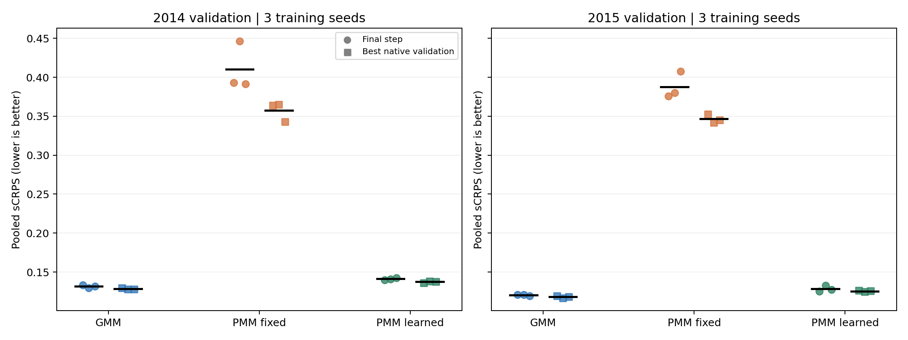
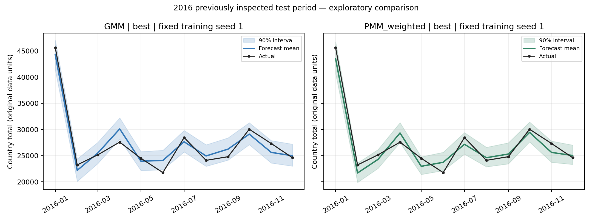

# PMM 追加檢查結果（2026-11-08）

已完成 **18 次正式訓練**：3 個設定 × 3 個訓練種子 × 2 個驗證年度。每次保存最後權重與內部驗證最佳權重，共 36 組驗證預測；選擇完成後，再計算 6 組 2016 預測。這些是本輪實際重訓結果，不是把原有分數重新排版。

依事先設定的平均驗證 pooled sCRPS，選出 **PMM_weighted / best**，平均驗證分數 **0.131467**。用最後權重作直接對照，PMM 加入可學習混合權重後，六組平均驗證誤差降低 **66.2%**，在 **6/6** 個年度／訓練種子組合較低。

原始教學為 [hierarchical_forecasting.ipynb](hierarchical_forecasting.ipynb)；最終 PMM 版本為 [hierarchical_forecasting_Poisson.ipynb](hierarchical_forecasting_Poisson.ipynb)。中間實驗程式與逐次訓練紀錄已於 2026-11-12 整理移除（仍可從 git 第一個 commit 取回）。

## 最值得改善的地方

### 1. 階層順序必須正確

本機確認原始序列順序與 S 不一致。程式改用 S 的原始索引作為 ordered categorical 類別，並檢查訓練後的 `nf.uids`；S 最後 304 列維持單位矩陣。平均預測必須符合 `all = S @ bottom`。

不能把 S 單獨按字母排序，也不能把各序列的分位數直接加總。HINT 先對抽樣結果作 BottomUp，再重新計算分位數。

### 2. PMM 的混合權重比只降低學習率更值得檢查

固定權重與可學習權重 PMM 均使用 learning_rate=0.0003，其他訓練設定相同。`weighted=True` 讓每個預測位置的各 Poisson 成分機率可由網路學習；固定權重時每個成分占 10%。它同時增加了網路的權重輸出，因此這是完整配置的對照，不能宣稱把所有差異都獨立歸因於一個機制。

下表是兩個年度、三個訓練種子的平均與標準差；**數字越低越好**。標準差混合了年度差異與訓練波動，不是統計信賴區間。

| name | policy | runs | mean_scrps | std_scrps | min_scrps | max_scrps |
| --- | --- | --- | --- | --- | --- | --- |
| GMM | best | 6 | 0.123387 | 0.005756 | 0.116841 | 0.129433 |
| GMM | last | 6 | 0.125978 | 0.006295 | 0.119226 | 0.133244 |
| PMM_fixed | best | 6 | 0.351925 | 0.010352 | 0.342084 | 0.364859 |
| PMM_fixed | last | 6 | 0.398995 | 0.025713 | 0.375921 | 0.446449 |
| PMM_weighted | best | 6 | 0.131467 | 0.006631 | 0.124567 | 0.138212 |
| PMM_weighted | last | 6 | 0.134917 | 0.007499 | 0.125204 | 0.142656 |

各驗證年度分開比較：

| year | name | policy | mean | std |
| --- | --- | --- | --- | --- |
| 2014 | GMM | best | 0.128572 | 0.000751 |
| 2014 | GMM | last | 0.131603 | 0.001782 |
| 2014 | PMM_fixed | best | 0.357251 | 0.012418 |
| 2014 | PMM_fixed | last | 0.410157 | 0.031442 |
| 2014 | PMM_weighted | best | 0.137472 | 0.001030 |
| 2014 | PMM_weighted | last | 0.141305 | 0.001287 |
| 2015 | GMM | best | 0.118202 | 0.001276 |
| 2015 | GMM | last | 0.120352 | 0.000979 |
| 2015 | PMM_fixed | best | 0.346598 | 0.005345 |
| 2015 | PMM_fixed | last | 0.387832 | 0.017043 |
| 2015 | PMM_weighted | best | 0.125462 | 0.000841 |
| 2015 | PMM_weighted | last | 0.128530 | 0.004064 |

### 3. 早停不等於自動還原最佳模型

原程式沒有還原最佳 checkpoint；本輪在訓練 callback 保存內部 `ptl/val_loss` 最低的權重，再與最後權重比較。排除訓練前 sanity check 的第 0 步。下表差值為 best 減 last，負值代表還原內部最佳權重後，外部 pooled sCRPS 改善。

`early_stop_patience_steps=10` 在每 50 步檢查一次的設定下，代表 10 次驗證未改善，通常約為最佳步驟之後 500 個訓練步驟；不是只等待 10 個梯度更新。每次實際步數與最佳步數保存在 `validation_runs.csv`。

| name | mean_best_minus_last | best_improves_runs | total_runs |
| --- | --- | --- | --- |
| GMM | -0.002591 | 6 | 6 |
| PMM_fixed | -0.047070 | 6 | 6 |
| PMM_weighted | -0.003450 | 5 | 6 |

內部早停看的是階層整合前的指標，外部評估是 BottomUp 後的 pooled 指標，因此內部最佳 checkpoint 不保證最後表現最佳。本輪依完整驗證結果選擇使用 `best`，沒有直接假定 best 必勝。

### 4. 檢查誤差在哪個階層累積

以下是最後權重在六組驗證的平均診斷。bias 為預測減真值，正值表示高估；coverage90 為真值落在 90% 預測區間內的比例。

| name | level | bias | coverage90 | width90 |
| --- | --- | --- | --- | --- |
| GMM | Country | -982.9827 | 0.7500 | 4252.7132 |
| GMM | Country/State/Zone/Region/Purpose | -3.2335 | 0.9212 | 143.3831 |
| PMM_fixed | Country | 15728.5500 | 0.0833 | 13888.9046 |
| PMM_fixed | Country/State/Zone/Region/Purpose | 51.7387 | 0.9844 | 525.3201 |
| PMM_weighted | Country | -1670.3212 | 0.6250 | 4056.4663 |
| PMM_weighted | Country/State/Zone/Region/Purpose | -5.4945 | 0.9013 | 123.3641 |

這份階層有 304 條底層序列。BottomUp 下，全國的平均偏差等於底層平均偏差的 304 倍；因此每條底層看似不大的系統性高估，會累積成全國層級的大幅高估。

Country 每個年度只有 12 個月，單一年度的覆蓋率會以 1/12 為單位跳動，應搭配多年度與區間寬度解讀。

## 2016 結果：設定選定後的探索性檢查

2016 在 10 月的實驗中已經看過，**不是新的獨立盲測**。本輪選擇只依 2014、2015 驗證平均，不挑測試分數最好的種子，也沒有依本輪測試分數更換設定。各模型使用在 2015 fold 訓練的權重，以截至 2015-12 的歷史預測 2016；沒有把 2016 目標用於訓練。

| name | policy | runs | mean_scrps | std_scrps | min_scrps | max_scrps | mean_mae |
| --- | --- | --- | --- | --- | --- | --- | --- |
| GMM | best | 3 | 0.117225 | 0.001131 | 0.116281 | 0.118479 | 66.517971 |
| PMM_weighted | best | 3 | 0.117634 | 0.001308 | 0.116144 | 0.118595 | 64.728712 |

| name | policy | seed | pooled_scrps | mae | coverage90 |
| --- | --- | --- | --- | --- | --- |
| PMM_weighted | best | 1 | 0.118163 | 65.279536 | 0.892342 |
| PMM_weighted | best | 7 | 0.118595 | 65.199946 | 0.898949 |
| PMM_weighted | best | 21 | 0.116144 | 63.706655 | 0.893093 |
| GMM | best | 1 | 0.118479 | 66.974915 | 0.913213 |
| GMM | best | 7 | 0.116281 | 66.295963 | 0.922523 |
| GMM | best | 21 | 0.116916 | 66.283034 | 0.939790 |

圖示固定使用事先指定的訓練種子 1，不挑最好看的預測。

## 指標與資料適用性

- 主指標為 `2 * sum(pinball loss) / (98 * sum(abs(y)))`，按同一階層所有序列與月份共同加總；使用 0.01–0.49、0.51–0.99 共 98 個分位數，與上一輪外部定義一致。
- 每份驗證與測試預測都以 utilsforecast 合併 ID 後的計算結果交叉核對主指標。另保留 `native_series_scaled_crps_mean`，它先算逐序列比例再平均，兩者權重意義不同，不能混稱同一個數字。
- 2014 有 6 條全零驗證序列，2015 有 1 條。逐序列指標的 epsilon 分母會讓某些非零預測產生極大分數；這不是預測值本身一定同樣巨大。
- 資料的 89.28% 是非整數。PMM 程式允許非負小數，但 Poisson 本來是離散計數模型；能算 loss 不代表生成假設吻合。沒有擅自四捨五入或改變資料單位。
- Poisson 的單一成分平均數與變異數相同；混合後可以過度離散，不能用單一成分的限制概括整個 PMM。
- 季節性 naive 的指標另存 `seasonal_naive_2014.csv`、`seasonal_naive_2015.csv`。它的點預測有實際比較意義，但零寬區間只是退化分布，不是有校準能力的機率基準。

同一份 2015、seed=1、最後權重的預測，兩種彙總方式會得到以下不同數字。這不是重新調模型或挑分數；兩個指標都保留。全零序列的實際預測另存 `zero_series_diagnostics.csv`。

| name | pooled_scrps | native_series_scaled_crps_mean |
| --- | --- | --- |
| GMM | 0.120999 | 8605260100646.891602 |
| PMM_fixed | 0.375921 | 51347641934429.007812 |
| PMM_weighted | 0.125204 | 29311693464032.585938 |

另將分母有定義的序列與全零序列分開診斷：前者列出逐序列 sCRPS 的平均／中位數，後者列原資料單位的 MAE。這個表沒有拿來重新選模型，也沒有把全零序列從主要 pooled 指標刪掉。

| name | mean_scrps_positive_total_series | median_scrps_positive_total_series | mae_zero_total_series |
| --- | --- | --- | --- |
| GMM | 0.492144 | 0.316438 | 0.636468 |
| PMM_fixed | 0.947187 | 0.478246 | 1.561778 |
| PMM_weighted | 0.489216 | 0.320396 | 0.793954 |

## 可靠性與限制

- 18 次訓練均完整執行到 2000 步或共同早停條件；無時間中斷的訓練混入比較。
- 所有訓練使用同一份程式版本；每次都確認最佳權重重載可完全重現預測。
- 所有預測通過列數、ID／月份對齊、finite、分位數單調性、階層平均加總、評分公式等檢查。
- 三個訓練種子為 1、7、21；預測抽樣種子固定為 1。這次確實重新訓練，不是只改抽樣種子。
- 本輪 PMM 都使用 0.0003，沒有重新搜尋學習率、輸入長度或成分數，因此不能把選定設定稱為全域最佳參數。
- 兩個年度共享訓練歷史；三個種子、單一資料集仍不足以證明模型在所有資料上較好。沒有把相關的六組結果當作六個獨立資料集做顯著性宣稱。
- 本輪最佳 checkpoint 的判定仍採套件內部 sCRPS。若未來要改為直接監控整合後的 pooled 指標，需要另外設計實驗，不能把指標尺度或計算方式悄悄改掉。

本輪對原有 seed=1、2015 最後權重預測的重現差異：

| model | max_abs_prediction_difference | equal_within_1e_minus_6 |
| --- | --- | --- |
| GMM | 0.000000 | True |
| PMM_fixed | 0.000000 | True |
| PMM_weighted | 0.000000 | True |

## 使用選定的 PMM

最終版本見 `hierarchical_forecasting_Poisson.ipynb`，由原教學 notebook 直接改寫，從頭訓練即可重現。

選定 PMM 的核心設定：`learning_rate=0.0003`、`weighted=True`、`input_size=24`、`n_components=10`、`scaler_type='robust'`、權重策略 `best`。資料須先依 S 矩陣順序排列 unique_id。

如果下一階段還要調 `input_size` 或成分數，應另設驗證搜尋並保留後續未看過的時間區間；本輪的 2016 分數不適合反覆用來挑參數。
